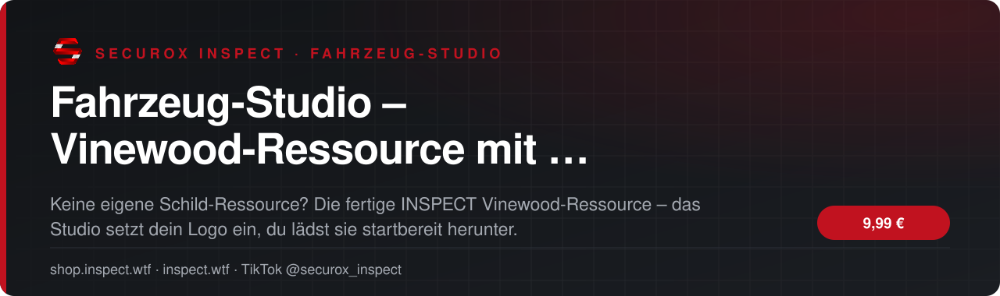
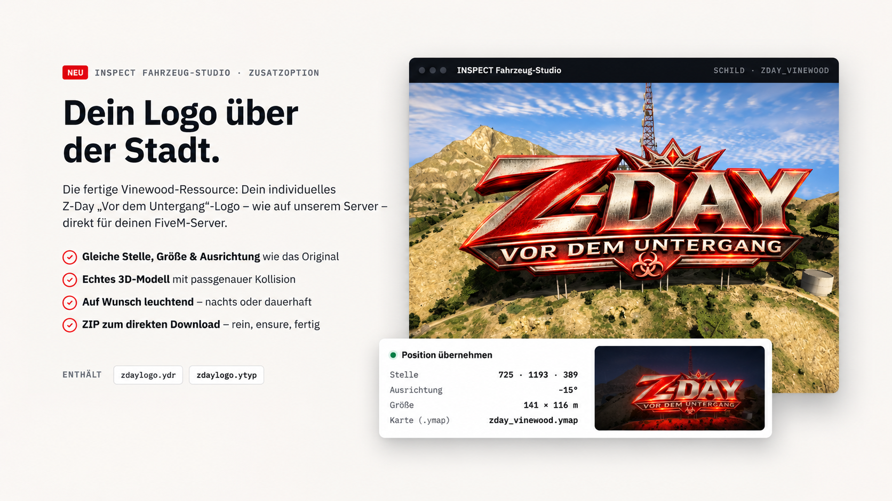
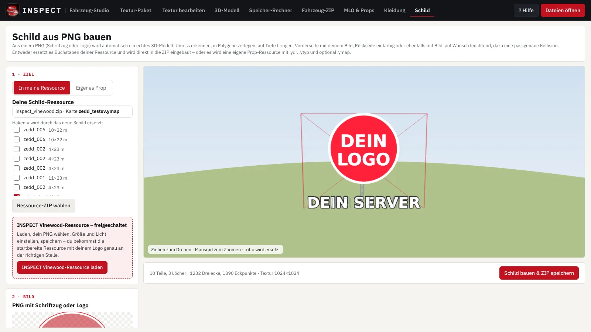

<!-- inspect-showcase: automatisch erzeugt, Änderungen bitte im Shop vornehmen -->

  
  
  
  

  
  
  

 

> 🇬🇧 **English:** Fahrzeug-Studio – Vinewood-Ressource mit deinem Logo – browser-based FiveM vehicle editor for .ytd/.yft files – textures, 3D models and optimisation by SecuroX Inspect. Purchase and licensing exclusively at [shop.inspect.wtf](https://shop.inspect.wtf). Product details below are in German – questions are welcome on [Discord](https://discord.gg/inspect).

 

## Das Wichtigste auf einen Blick

<table>
  <tr>
    <td width="50%" valign="top">✔&nbsp; <b>Fertige Vinewood-Ressource, im Studio mit einem Klick geladen</b></td>
    <td width="50%" valign="top">✔&nbsp; <b>Dein Logo oder Servername als 3D-Buchstaben mit Kollision</b></td>
  </tr>
  <tr>
    <td width="50%" valign="top">✔&nbsp; <b>Position am Hügel ist schon eingestellt</b></td>
    <td width="50%" valign="top">✔&nbsp; <b>Auf Wunsch nachts oder dauerhaft leuchtend</b></td>
  </tr>
</table>

## Überblick

Du willst deinen Servernamen oder dein Logo statt der Vinewood-Buchstaben über der Stadt, hast aber keine passende Ressource? Dann nimm unsere fertige INSPECT Vinewood-Ressource.

So läuft es: Im Fahrzeug-Studio im Bereich „Schild“ auf „Fertige Vinewood-Ressource verwenden“ klicken – die Ressource wird direkt geladen. Dann dein PNG wählen, Größe, Tiefe und Licht einstellen und speichern. Du bekommst die komplette, startbereite FiveM-Ressource mit deinem Logo als ZIP zum direkten Download: in den resources-Ordner legen, ensure eintragen, fertig.

Die Ressource ist dauerhaft in deinem Konto freigeschaltet – du kannst dein Schild jederzeit neu bauen, zum Beispiel wenn sich dein Logo ändert. Zum Speichern brauchst du zusätzlich eine Einzelbearbeitung oder den Ressourcen-Baukasten-Pass (bzw. Komplett-Pass).

## Kompatibilität

| | |
|:--|:--|
| Plattform | FiveM (GTA V) |

## Alle weiteren Funktionen

- Startbereite Ressource als ZIP zum direkten Download
- Dauerhaft im Konto – Schild jederzeit neu bauen
- Nutzung auf deinen eigenen Servern, kein Weiterverkauf
- Zum Speichern: Einzelbearbeitung oder Ressourcen-/Komplett-Pass

## Einblicke

<table>
  <tr>
    <td width="50%"></td>
    <td width="50%"></td>
  </tr>
</table>

## In Aktion sehen

- 🎞️ Videos direkt auf der [Produktseite im Shop](https://shop.inspect.wtf/produkt/fahrzeug-studio-vinewood-ressource)

Neue Clips und Vorschauen regelmäßig auf TikTok: **[@securox_inspect](https://www.tiktok.com/@securox_inspect)**

## Preis

**9,99 €** &nbsp;–&nbsp; einmaliger Kaufpreis · Download und Lizenz im Kundenkonto

Sichere Zahlung mit PayPal oder Kreditkarte · Rechnung als PDF · Support auf Deutsch

## So einfach geht's

1. **Im Shop kaufen** – sicher bezahlen mit PayPal oder Kreditkarte.
2. **Sofort loslegen** – Download und Lizenz stehen direkt nach Zahlungseingang in deinem Kundenkonto bereit, die Rechnung erhältst du als PDF.
3. **Einrichten** – bei Fragen hilft dir unser Support im Discord weiter.

## Warum INSPECT?

<table>
  <tr>
    <td width="50%" valign="top"><b>🇩🇪 Entwickelt in Deutschland</b> Konzeption, Entwicklung und Support aus einer Hand.</td>
    <td width="50%" valign="top"><b>💬 Persönlicher Support</b> Schnelle Hilfe auf Deutsch im INSPECT Discord.</td>
  </tr>
  <tr>
    <td width="50%" valign="top"><b>🔒 Sichere Zahlung</b> PayPal oder Kreditkarte, Rechnung automatisch als PDF.</td>
    <td width="50%" valign="top"><b>⚡ Sofort verfügbar</b> Download und Lizenz direkt nach der Zahlung im Kundenkonto.</td>
  </tr>
</table>

## Häufige Fragen

<b>Wie erhalte ich das Produkt?</b>

 

Nach bestätigter Zahlung stehen Download und Lizenz in deinem Kundenkonto bereit. Die Rechnung erhältst du als PDF.

<b>Bekomme ich Hilfe bei der Einrichtung?</b>

 

Ja – unser Support hilft dir im [INSPECT Discord](https://discord.gg/inspect) persönlich und auf Deutsch.

<b>Wo kaufe ich offiziell?</b>

 

Ausschließlich im INSPECT Shop unter [shop.inspect.wtf](https://shop.inspect.wtf). Angebote von Dritten stammen nicht von uns.

## Kontakt

| | |
|:--|:--|
| 🛒 Shop | [shop.inspect.wtf](https://shop.inspect.wtf) |
| 🌐 Website | [inspect.wtf](https://inspect.wtf) |
| 💬 Discord | [discord.gg/inspect](https://discord.gg/inspect) |
| 🎬 TikTok | [@securox_inspect](https://www.tiktok.com/@securox_inspect) |
| ✉️ E-Mail | [info@inspect.wtf](mailto:info@inspect.wtf) |

---

<b>SecuroX Inspect</b> · Offizielle Produktpräsentation · Dieses Repository enthält keinen Quellcode und keine Produktdateien. 
Kauf und Lizenzen ausschließlich über <a href="https://shop.inspect.wtf">shop.inspect.wtf</a> · Inhalte werden automatisch aus dem Shop aktualisiert.

